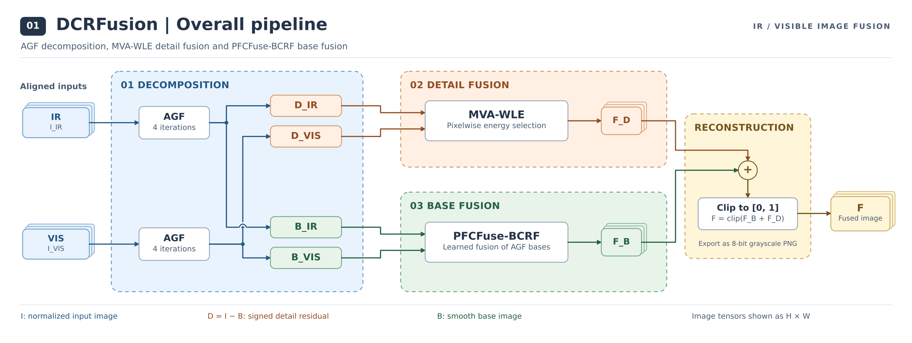
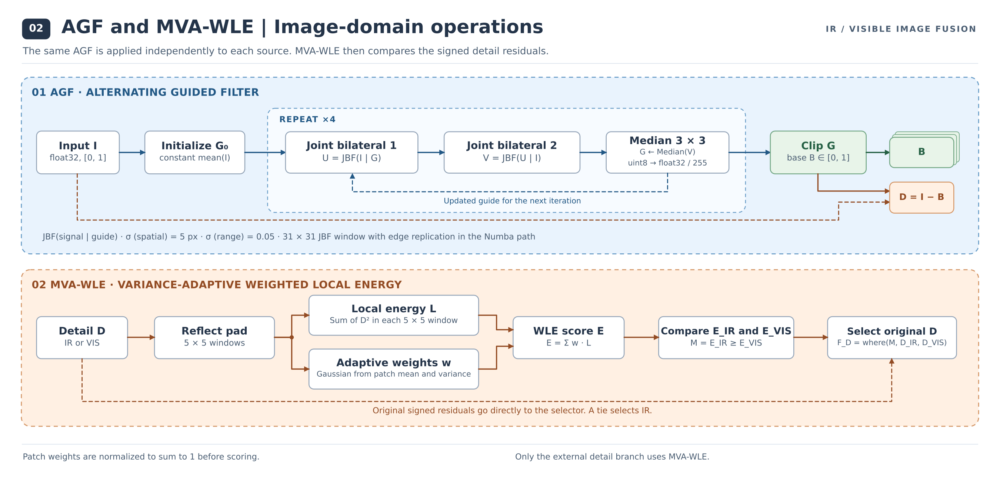
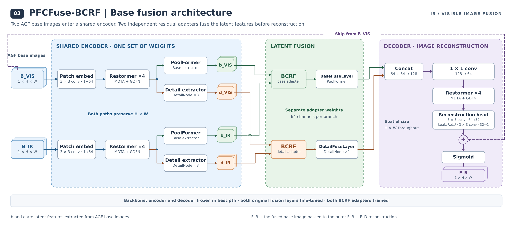
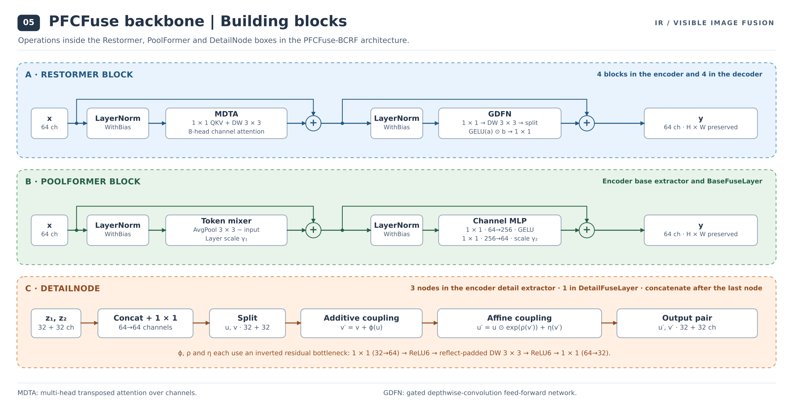
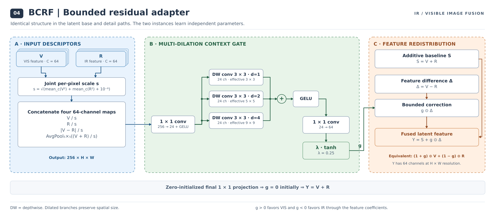

# DCRFusion: Hợp nhất ảnh hồng ngoại và ảnh khả kiến

Dự án nghiên cứu hợp nhất ảnh hồng ngoại (IR) và ảnh khả kiến (VIS). Pipeline tách mỗi ảnh thành thành phần base/detail bằng Adaptive Guided Filter (AGF), hợp nhất detail bằng MVA-WLE và hợp nhất base bằng backbone PFCFuse. Một nhánh thử nghiệm bổ sung Bounded Correction Residual Fusion (BCRF) để điều chỉnh phép cộng đặc trưng của PFCFuse trong khi vẫn giữ nguyên backbone pretrained.

> **Phạm vi kết quả:** các bảng benchmark DCRFusion trong repository được tính trên 80 cặp MSRS. Chúng không phải kết quả của một lần huấn luyện residual BCRF mới theo quy trình train/validation/test ở dưới. README của nhánh cải tiến hiện ghi nhận chưa có checkpoint BCRF được validation chấp nhận để khẳng định cải thiện trên test độc lập.

## Kiến trúc



Pipeline xử lý ảnh như sau:

1. Đọc cặp IR/VIS đã căn chỉnh và chuyển về ảnh xám chuẩn hóa trong khoảng [0, 1].
2. AGF phân rã từng ảnh thành base $B$ và detail $D=I-B$.
3. MVA-WLE chọn detail theo năng lượng cục bộ từng pixel; PFCFuse hợp nhất hai thành phần base.
4. Cộng hai thành phần đã hợp nhất và giới hạn kết quả trong [0, 1], sau đó xuất ảnh xám 8-bit.



### PFCFuse và BCRF

PFCFuse mã hóa hai modality, hợp nhất đặc trưng base/detail, rồi giải mã thành ảnh. Ảnh VIS được đưa vào decoder như một skip connection. Sơ đồ backbone và các khối của PFCFuse:





BCRF là nhánh thử nghiệm trong `base_PFCFuse_improve`: với đặc trưng khả kiến $V$ và hồng ngoại $R$, adapter tạo

$$
Y = V + R + g \odot (V-R), \qquad g=0.25\tanh(h_\theta(V,R)).
$$

Gate được khởi tạo bằng 0, nên ban đầu phép hợp nhất đúng bằng phép cộng của PFCFuse gốc. Backbone được đóng băng theo mặc định; adapter base/detail được học riêng.



### Cấu trúc repository

| Đường dẫn             | Vai trò                                                       |
| ------------------------- | -------------------------------------------------------------- |
| `decomposition/`        | AGF và các bộ lọc liên quan                               |
| `detail_fusion/`        | MVA-WLE, MLE và các phương pháp detail fusion             |
| `base_PFCFuse/`         | PFCFuse gốc và checkpoint `PFCFuse_IVF.pth`                |
| `base_PFCFuse_improve/` | BCRF, cache dữ liệu, huấn luyện, đánh giá và inference |
| `compare/`              | Các phương pháp đối chứng cho thành phần base/detail  |
| `image_architecture/`   | Các sơ đồ kiến trúc được nhúng trong README này     |
| `output/`               | Ảnh kết quả và bảng metric đã lưu                      |
| `metric/`               | Hàm đánh giá ảnh hợp nhất                               |

## Dữ liệu

Bộ dữ liệu tham chiếu: [MSRS](https://github.com/Linfeng-Tang/MSRS.git). Hãy tải và sử dụng dữ liệu theo điều khoản của repository MSRS. Các ảnh IR/VIS phải được căn chỉnh, có cùng kích thước và ID/tên file tương ứng.

Trainer BCRF nhận một thư mục nguồn có đúng hai thư mục con `vi/` và `ir/`, trong đó hai bên có cùng tập image stem. Ví dụ bố trí dữ liệu sau khi tải và kiểm tra cấu trúc MSRS:

```text
data/MSRS_source/
  train/
    vi/
    ir/
  test/
    vi/
    ir/
```

Nếu cấu trúc tải về khác ví dụ này, hãy trỏ `--source` tới thư mục chứa trực tiếp `vi/` và `ir/`. Không dùng test để chọn epoch hoặc siêu tham số. Với dữ liệu có scene/sequence, nên cung cấp danh sách validation theo scene để tránh đưa các frame gần nhau vào cả train lẫn validation.

Thư mục `data/MSRS/` trong repository hiện có `vi/` và `ir/`, được các script benchmark gốc dùng theo quy ước tên ảnh `01.png` đến `80.png`. Không mặc định rằng thư mục này đã được chia train/test.

## Cài đặt

Yêu cầu nhánh BCRF: Python 3.8 trở lên và PyTorch 2.6 trở lên. GPU CUDA được khuyến nghị để huấn luyện và đánh giá ảnh kích thước đầy đủ. Cài PyTorch phù hợp với CUDA/CPU theo hướng dẫn chính thức, sau đó cài các thư viện Python:

```powershell
python -m pip install numpy opencv-python scipy numba kornia timm einops scikit-image scikit-learn pandas matplotlib openpyxl
```

Các lệnh bên dưới chạy từ thư mục gốc repository. Chi tiết môi trường, kiểm thử và tùy chọn khác xem [`base_PFCFuse_improve/README.md`](base_PFCFuse_improve/README.md).

## Huấn luyện BCRF

Quy trình này huấn luyện adapter trên đúng miền đầu vào của pipeline AGF + WLE. Bước chuẩn bị chạy AGF/WLE trên ảnh đầy đủ, rồi lưu cache và chia train/validation theo image pair:

```powershell
python -m base_PFCFuse_improve.data --source data/MSRS_source/train --output base_PFCFuse_improve/cache/msrs_agf_wle --mode agf --detail-fusion wle --val-fraction 0.15 --seed 3407
```

Huấn luyện adapter từ checkpoint PFCFuse gốc. Thư mục output phải chưa tồn tại; mỗi lần chạy nên dùng tên run mới:

```powershell
python -m base_PFCFuse_improve.train_residual --cache base_PFCFuse_improve/cache/msrs_agf_wle --output base_PFCFuse_improve/runs/msrs_agf_wle_s3407 --epochs 20 --batch-size 4 --crop 128 --lr 0.001 --seed 3407 --device cuda
```

Thay `--device cuda` bằng `--device cpu` nếu không có GPU, nhưng validation full-image có thể chậm. Trainer chọn checkpoint dựa trên validation gate; `selected.pth` có thể vẫn là baseline. Nếu `history.json` ghi `selected_epoch = -1` hoặc `baseline_retained`, nghĩa là chưa có epoch nào được chấp nhận. Không thay bằng `last.pth` chỉ vì loss train thấp hơn.

Đánh giá trên tập test độc lập: tạo cache test riêng, sau đó so sánh checkpoint đã chọn với PFCFuse gốc trên cùng cặp ảnh.

```powershell
python -m base_PFCFuse_improve.data --source data/MSRS_source/test --output base_PFCFuse_improve/cache/msrs_test_agf_wle --mode agf --detail-fusion wle --split test
python -m base_PFCFuse_improve.evaluation --cache base_PFCFuse_improve/cache/msrs_test_agf_wle --checkpoint base_PFCFuse_improve/runs/msrs_agf_wle_s3407/selected.pth --output base_PFCFuse_improve/reports/msrs_test_wle_s3407 --device cuda
```

Kết quả gồm `report.json`, `per_image.csv` và ảnh baseline/candidate. Cờ `supported_on_this_split` chỉ là bằng chứng trên split đã chạy, không thay thế đánh giá trên scene hoặc dataset mới.

## Inference

Chạy ảnh MSRS bằng checkpoint BCRF đã chọn:

```powershell
python -m base_PFCFuse_improve.infer --source data/MSRS_source/test --checkpoint base_PFCFuse_improve/runs/msrs_agf_wle_s3407/selected.pth --output output/inference_bcrf_wle --mode agf --detail-fusion wle --device cuda
```

Chạy baseline PFCFuse gốc với cùng pipeline AGF + WLE để đối chiếu:

```powershell
python -m base_PFCFuse_improve.infer --source data/MSRS_source/test --checkpoint base_PFCFuse_improve/PFCFuse_IVF.pth --output output/inference_pfcfuse_wle --mode agf --detail-fusion wle --device cuda
```

`--source` cần có cặp ảnh cùng ID trong `vi/` và `ir/`. `--detail-fusion` khi inference phải khớp cấu hình dùng để tạo checkpoint; dùng `--limit 1` cho smoke test. Output phải là thư mục mới, chương trình không ghi đè kết quả cũ.

### Chạy script benchmark gốc

`main.py` dùng đường dẫn cố định `data/MSRS/{vi,ir}` và xử lý 80 cặp tên từ `01.png` đến `80.png`:

```powershell
python main.py
```

**Lưu ý trạng thái code:** `main.py` hiện nạp PFCFuse gốc từ `base_PFCFuse/` và gọi `MLE(detail_ir, detail_vi)`, dù có import hàm WLE. Vì vậy lệnh này chưa thực thi đầy đủ sơ đồ DCRFusion/MVA-WLE/BCRF ở trên. Muốn benchmark cấu hình BCRF + WLE, dùng entry point `base_PFCFuse_improve.infer` và checkpoint/config tương ứng; không xem output của `main.py` là kết quả BCRF.

## Kiểm thử

```powershell
python -m unittest base_PFCFuse_improve.test_improve -v
```

Các unit/integration test xác minh hành vi code và pipeline trên dữ liệu kiểm thử nhỏ; chúng không chứng minh chất lượng fusion tăng trên MSRS.
